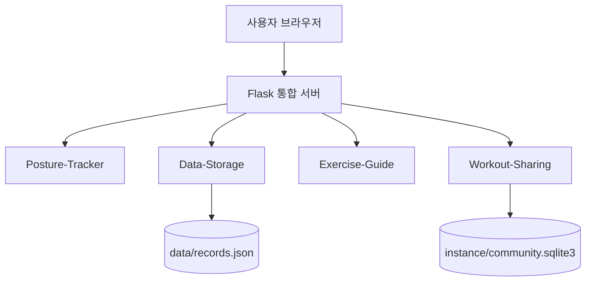

<div align="center">

# 🏋️ 맨몸 운동 자세 평가 프로그램

### AI 기반 실시간 자세 분석 · 운동 기록 · 교정 가이드 · 운동 커뮤니티

**웹캠으로 운동 자세를 확인하고, 운동 기록을 관리하며, 교정 정보와 운동 경험을 한곳에서 공유하는 웹 서비스입니다.**

[](https://www.python.org/)
[](https://flask.palletsprojects.com/)
[](https://developer.mozilla.org/ko/docs/Web/JavaScript)
[](https://www.sqlite.org/)
[](LICENSE)

[**주요 기능**](#-주요-기능) · [**설치와 실행**](#-설치와-실행) · [**사용법**](#-사용법) · [**팀원**](#-팀원) · [**기여하기**](#-기여하기)

</div>

---

## 💡 프로젝트 소개

헬스장이나 트레이너 없이 혼자 맨몸 운동을 할 때에도 **운동 자세를 확인하고, 운동 결과를 기록하며, 다음 운동에 참고할 정보**를 얻을 수 있도록 만든 프로젝트입니다.

이 저장소는 다음 네 가지 기능을 하나의 웹 애플리케이션으로 통합합니다.

- **실시간 자세 분석:** 웹캠을 통해 운동 자세를 확인하고 분석 결과를 표시합니다.
- **운동 기록 대시보드:** 저장된 세션을 조회하고 운동 수행 결과를 살펴봅니다.
- **운동 가이드:** 운동 종목별 안내와 자세 교정 정보를 제공합니다.
- **운동 정보 공유:** 커뮤니티에서 운동 경험과 팁을 게시글로 공유합니다.

> **프로젝트 범위:** 학교 오픈소스 소프트웨어 팀프로젝트에서 개발한 로컬 실행형 웹 서비스입니다. 전문적인 의학적 진단이나 부상 판정을 대신하지 않습니다.

## 📸 실행 화면

<!-- 스크린샷 삽입 안내
1. 실제 실행 화면을 캡처해 docs/images/ 폴더에 저장합니다.
2. 아래 '화면 캡처 추가 예정' 안내문을 지우고 다음 마크다운을 삽입합니다.


3. 교수님 평가 요건: 최소 한 장은 실제 실행 화면이어야 합니다.
4. 파일은 이미지 추가 PR과 함께 커밋해 주세요. 아직 없는 파일을 img src로 가리키지 않아 깨진 이미지를 표시하지 않습니다.
-->

> 📷 **실행 화면 캡처 추가 예정**  
> 메인 화면 · 실시간 자세 분석 · 운동 기록 대시보드 · 운동 가이드 · 커뮤니티 중 실제 화면을 캡처해 여기에 추가합니다.

## 🧩 주요 기능

| 기능 | 설명 | 담당 |
| :--- | :--- | :---: |
| **Posture-Tracker** | 웹캠 기반 실시간 운동 자세 분석과 피드백 화면 제공 | 김원빈 |
| **Data-Storage** | 운동 세션 저장·조회 및 대시보드에서 기록과 통계 확인 | 김성재 |
| **Exercise-Guide** | 운동 종목별 동작 안내 및 자세 교정 가이드 제공 | 전승희 |
| **Workout-Sharing** | 운동 정보 공유 게시글 작성·조회 및 종목별 필터링 | 민유경 |

### 기능별 화면으로 이동하기

| 메뉴 | 실행 주소 | 주요 동작 |
| :--- | :--- | :--- |
| 메인 / 커뮤니티 | [`/`](http://127.0.0.1:8000/), [`/#community`](http://127.0.0.1:8000/#community) | 소개 화면 확인, 게시글 작성·조회 |
| AI 자세 분석 | [`/tracker/`](http://127.0.0.1:8000/tracker/) | 카메라로 자세 분석 |
| 운동 기록 대시보드 | [`/dashboard/`](http://127.0.0.1:8000/dashboard/) | 운동 세션 및 통계 확인 |
| 운동 가이드 | [`/guide/`](http://127.0.0.1:8000/guide/) | 운동 동작·교정 안내 |

> 위 링크는 **로컬 서버를 실행한 후**, 해당 컴퓨터의 브라우저에서 이용할 수 있습니다.

### 프로그램 구성



통합 실행 진입점은 `main.py`이며, 운동 세션 데이터와 커뮤니티 게시글은 각각 로컬 저장 파일을 사용합니다.

## 🚀 설치와 실행

### 실행 환경

- **Python:** 3.12 이상 (팀 테스트 환경: **Python 3.13**)
- **운영 환경:** Windows 기준 `setup.cmd` / `start.cmd` 제공
- **필수:** Git, 웹 브라우저
- **선택:** 웹캠 (실시간 자세 분석 기능 사용 시 필요)

### 방법 1. 명령어로 설치 및 실행

프로젝트 저장소를 내려받고 Python 의존성을 설치한 다음 서버를 실행합니다.

```bash
# 1) 저장소 복제
git clone https://github.com/opensourcesoftware-4team/Exercise_Posture.git
cd Exercise_Posture

# 2) 필요한 패키지 설치
python -m pip install -r requirements.txt

# 3) 통합 서버 실행
python main.py
```

**실행 결과:** 서버가 시작되면 브라우저에서 **http://127.0.0.1:8000/** 으로 접속합니다. 종료하려면 서버를 실행한 터미널에서 `Ctrl+C`를 누릅니다.

> `python` 명령이 인식되지 않는 환경에서는 Python이 설치되어 있고 실행 경로에 등록되어 있는지 확인해 주세요.

### 방법 2. Windows에서 간편 실행

1. 저장소 폴더의 **`setup.cmd`** 를 더블클릭해 `.venv` 가상환경과 필요한 Python 패키지를 준비합니다.
2. **`start.cmd`** 를 더블클릭해 서버를 실행합니다.
3. 브라우저에서 **http://127.0.0.1:8000/** 에 접속합니다.

> 간편 실행을 처음 사용할 때는 `setup.cmd`를 먼저 실행해 주세요.

## 🕹️ 사용법

아래 예시는 **로컬 서버를 실행한 상태**에서 진행합니다.

### 1. 웹캠으로 운동 자세 분석하기

1. 메인 화면에서 **AI 자세 분석** 메뉴를 선택하거나 `/tracker/`에 접속합니다.
2. 화면에서 운동 종목을 선택하고 브라우저의 **카메라 사용 권한**을 허용합니다.
3. 전신이 카메라 화면에 들어오도록 위치를 조정한 다음 운동합니다.
4. **결과:** 화면에서 실시간 운동 자세 분석 결과와 피드백을 확인합니다. 운동 기록을 저장할 경우 해당 화면에서 제공하는 기록 기능을 이용합니다.

### 2. 운동 기록과 통계 확인하기

1. **운동 기록 대시보드** 메뉴를 선택하거나 `/dashboard/`에 접속합니다.
2. 기록이 저장되어 있다면 세션 수, 정확도 등 요약 정보와 운동 기록을 확인합니다.
3. **결과:** 저장된 운동 세션을 목록과 시각화된 통계로 살펴볼 수 있습니다. 기록이 없다면 먼저 자세 분석 기능에서 운동을 진행해 주세요.

### 3. 종목별 운동 가이드 확인하기

1. **운동 가이드** 메뉴를 선택하거나 `/guide/`에 접속합니다.
2. 스쿼트·푸시업·플랭크 등 제공되는 운동 종목을 선택합니다.
3. **결과:** 선택한 종목의 동작 안내와 자세 교정 정보를 확인할 수 있습니다.

### 4. 커뮤니티에 운동 팁 공유하기

1. 메인 화면의 **Community** 영역(`/#community`)으로 이동합니다.
2. **글쓰기**를 선택하고 닉네임, 운동 종류, 제목, 내용을 작성해 게시글을 등록합니다.
3. 목록에서 운동 종목 필터를 선택하거나 게시글을 열어 자세한 내용을 확인합니다.
4. **결과:** 작성한 글이 커뮤니티에 표시되고, 운동 종류별로 게시글을 찾아볼 수 있습니다.

> 현재 README는 통합 MVP에 포함된 기능을 중심으로 설명합니다. 개발 중인 댓글·게시글 수정 등의 기능은 실제 병합과 검증이 완료되기 전까지 제공 기능으로 안내하지 않습니다.

## ⚙️ 실행 및 데이터 관련 참고 사항

| 항목 | 내용 |
| :--- | :--- |
| 기본 서버 주소 | `127.0.0.1:8000` (브라우저 접속 주소) |
| 서버 바인딩 | `HOST` 기본값 `0.0.0.0`, `PORT` 기본값 `8000` |
| 운동 세션 저장 | `data/records.json` |
| 커뮤니티 게시글 저장 | `instance/community.sqlite3` |
| Python 웹 서버 | Flask + Waitress |

- **카메라 사용:** 브라우저 보안 정책상 카메라는 일반적으로 `localhost` 또는 보안 연결(HTTPS)에서 사용할 수 있습니다. 같은 Wi-Fi의 다른 기기에서 PC의 IP 주소로 HTTP 접속하면 카메라 기능이 제한될 수 있습니다.
- **다른 기기에서 접속:** 같은 네트워크에서 서버 PC의 IP 주소와 포트를 사용해 접근할 수 있지만, Windows 방화벽이나 학교·공공 Wi-Fi의 기기 간 통신 제한으로 연결되지 않을 수 있습니다.
- **데이터 보관:** 운동 세션과 게시글은 실행하는 컴퓨터에 로컬 저장됩니다. 실행 중 생성된 사용자 데이터는 일반적으로 Git으로 공유하지 않습니다.
- **포트 변경:** 필요하면 `HOST`, `PORT` 환경변수로 서버 실행 주소 및 포트를 변경할 수 있습니다.

## 🧪 테스트 (개발 및 기여자용)

Python 테스트는 프로젝트 루트에서 실행합니다.

```bash
# pytest가 없다면 설치
python -m pip install pytest

# 서버 및 기능 테스트
python -m pytest tests
```

JavaScript 트래커 판정 테스트는 **Node.js 22 이상**이 설치된 경우 아래 명령으로 실행할 수 있습니다.

```bash
node --test "tests/js/*.test.js"
```

> 테스트 환경과 파일 구성은 브랜치별로 달라질 수 있습니다. 실행 오류가 있다면 해당 브랜치의 `tests/` 디렉터리를 확인해 주세요.

## 👥 팀원

**오픈소스 소프트웨어 · 4팀**

<!-- 팀원 사진 삽입 안내
프로필 사진을 docs/images/team/에 넣은 뒤 아래 표의 '📷 사진 추가 예정' 텍스트를 다음 태그로 교체해 주세요.
- 전승희: 
- 김원빈: 
- 김성재: 
- 민유경: 
사진 파일명과 확장자는 자유롭게 바꿔도 되지만, src 경로를 실제 파일명에 맞춰 주세요.
-->

| 프로필 사진 | 이름 | 역할 | GitHub |
| :---: | :---: | :--- | :--- |
| 📷 사진 추가 예정 | **전승희** | 팀장 | [@JSH-04](https://github.com/JSH-04) |
| 📷 사진 추가 예정 | **김원빈** | 개발 리드 | [@plmokn044330-ship-it](https://github.com/plmokn044330-ship-it) |
| 📷 사진 추가 예정 | **김성재** | 문서 담당 | [@sjae938](https://github.com/sjae938) |
| 📷 사진 추가 예정 | **민유경** | 리뷰·품질 담당 | [@Minyou-gyeong](https://github.com/Minyou-gyeong) |

## 🤝 기여하기

처음 참여하는 분도 환영합니다. 문서 개선, 사용성 테스트 등 입문자를 위한 작업은 GitHub Issues의 **`good first issue`** 라벨에서 확인할 수 있습니다.

- **기여 절차:** [CONTRIBUTING.md](CONTRIBUTING.md)
- **커뮤니티 행동 수칙:** [CODE_OF_CONDUCT.md](CODE_OF_CONDUCT.md)
- **이슈 확인:** [GitHub Issues](https://github.com/opensourcesoftware-4team/Exercise_Posture/issues)
- **변경 제안:** [Pull Requests](https://github.com/opensourcesoftware-4team/Exercise_Posture/pulls)

기능 제안이나 버그 제보는 이슈로 남겨 주시고, PR을 열기 전에 해당 기능의 현재 구현 범위와 테스트 방법을 확인해 주세요.

## 📄 라이선스

MIT License — see [LICENSE](LICENSE).

---

<div align="center">

**Exercise_Posture · Open Source Software Team 4**

</div>
