# MOTION AI 커뮤니티 사용자 가이드

MOTION AI의 커뮤니티에서 운동 경험과 자세 교정 팁을 게시글로 작성·조회하고, 댓글을 남기고, 내가 쓴 글을 삭제하는 방법을 안내합니다. 처음 사용하는 사람도 화면의 버튼을 순서대로 따라 할 수 있도록 구성했습니다.

> **확인 범위:** GitHub `main` 브랜치의 `README.md`, `static/index.html`, `static/community.js`, `static/community-api.js`, `app.py`, `post_storage.py`를 확인했습니다. 실제 사용자 테스트에서는 **로컬 환경의 커뮤니티 접속·게시글 작성·조회·운동 종류 필터 기능에 문제가 없었다**고 확인되었습니다. 아래 단계별 동작은 코드와 해당 사용자 확인에 근거합니다. 서버 재시작 후 데이터 보존 등 별도로 수행 여부를 확인하지 못한 시험은 구분해 적었습니다.
>
> **추가 기능 확인 범위:** 운동 기록 첨부(#7), 댓글(#18), 게시글 삭제(#23)는 `Feature/community-post-delete` 브랜치의 `static/index.html`, `static/community.js`, `app.py`, `post_storage.py`와 자동 테스트(`tests/test_record_attachment.py`, `tests/test_comments.py`, `tests/test_post_delete.py`)를 근거로 적었습니다. 또한 테스트용 운동 기록 2건을 넣은 로컬 서버를 실행하고 브라우저로 화면을 직접 조작해 작성·첨부·댓글·삭제를 확인했으며, 그 화면을 각 섹션에 캡처로 첨부했습니다. 기존 기능의 '사용자 직접 사용 확인'과 구분해 **로컬 실행 확인**으로 표시합니다.

## 1. 커뮤니티에 접속하기

1. 프로젝트 [README의 설치·실행 안내](../README.md#-설치와-실행)에 따라 **내 컴퓨터에서** MOTION AI 서버를 실행합니다. Windows에서는 `setup.cmd`로 처음 설치한 뒤 `start.cmd`를 사용할 수 있습니다.
2. 같은 컴퓨터의 브라우저에서 `http://127.0.0.1:8000/#community`에 접속합니다. 또는 메인 화면 상단의 **Community** 메뉴를 누릅니다.
3. **함께 나누는 운동 이야기.**라는 제목과 게시글 목록, 운동 종류별 필터가 표시되는지 확인합니다.

**확인 결과:** 사용자가 로컬 환경에서 커뮤니티 접속이 정상 작동했다고 확인했습니다. 게시글이 하나도 없으면 **아직 등록된 이야기가 없어요.**라는 안내가 표시되도록 구현되어 있습니다.
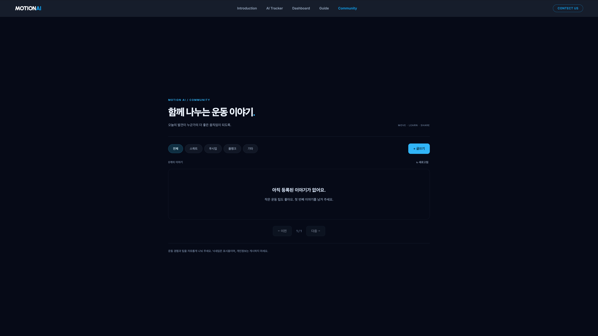
## 2. 게시글 작성하기

1. 커뮤니티 목록의 **+ 글쓰기** 버튼을 누릅니다.
2. **닉네임**, **운동 종류**, **제목**, **내용**을 입력합니다.
   - 운동 종류: **스쿼트 / 푸시업 / 플랭크 / 기타** 중 선택
   - 닉네임: 1~20자, 제목: 1~100자, 내용: 1~5,000자(앞뒤 공백 제외)
3. (선택) **내 운동 기록 첨부**에서 AI 자세 분석으로 저장한 기록 하나를 고릅니다. 첨부하지 않으려면 **첨부하지 않음**을 그대로 둡니다.
   - 고른 기록의 운동 종류·측정 일시·횟수(플랭크는 유지 시간)·자세 정확도·촬영 방향이 글과 함께 공개됩니다. 고르지 않은 기록은 공개되지 않습니다.
   - 운동 기록은 **기록을 측정한 서버 PC에서 접속했을 때만** 첨부할 수 있습니다.
4. **삭제 PIN**에 숫자 4자리를 입력합니다(필수). 나중에 이 글을 삭제할 때 필요하니 기억해 두고, 남이 짐작하기 어려운 숫자로 정합니다.
5. 내용을 확인하고 **게시글 등록** 버튼을 누릅니다. 등록한 글은 **수정할 수 없습니다.**
6. 목록으로 돌아왔을 때 작성한 글이 나타나는지 확인합니다. 운동 기록을 첨부한 글에는 **📊 기록 첨부** 표시가 붙습니다.

**확인 결과:** 로컬 환경에서 게시글 작성이 정상 작동했다는 사용자 확인이 있습니다. 코드상 정상 등록 시 목록으로 돌아가고 **게시글이 등록되었습니다.**라는 안내를 표시합니다. 빈 입력이나 길이 제한 위반 시 해당 항목에 오류 안내가 나타납니다. 운동 기록 첨부와 삭제 PIN 입력은 로컬 서버에서 실행해 확인했습니다(아래 캡처). 첨부한 글은 목록에 **📊 기록 첨부** 표시가 붙습니다.

**연습용 예시:** 닉네임 `테스트사용자` / 운동 종류 `스쿼트` / 제목 `스쿼트 자세 팁` / 내용 `무릎과 발끝의 방향을 확인합니다.`
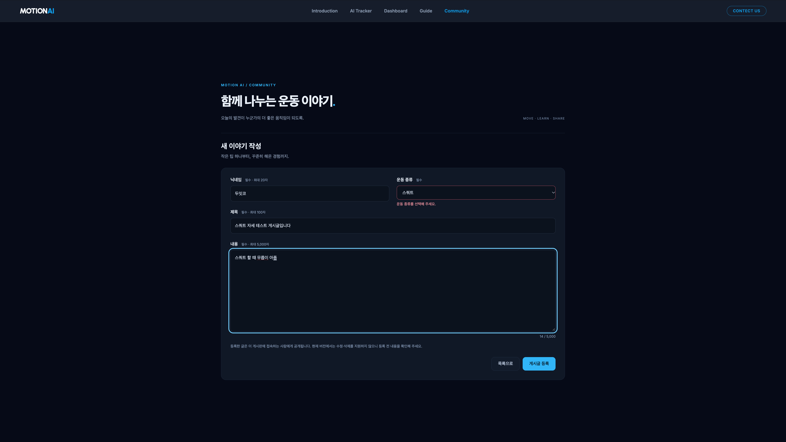
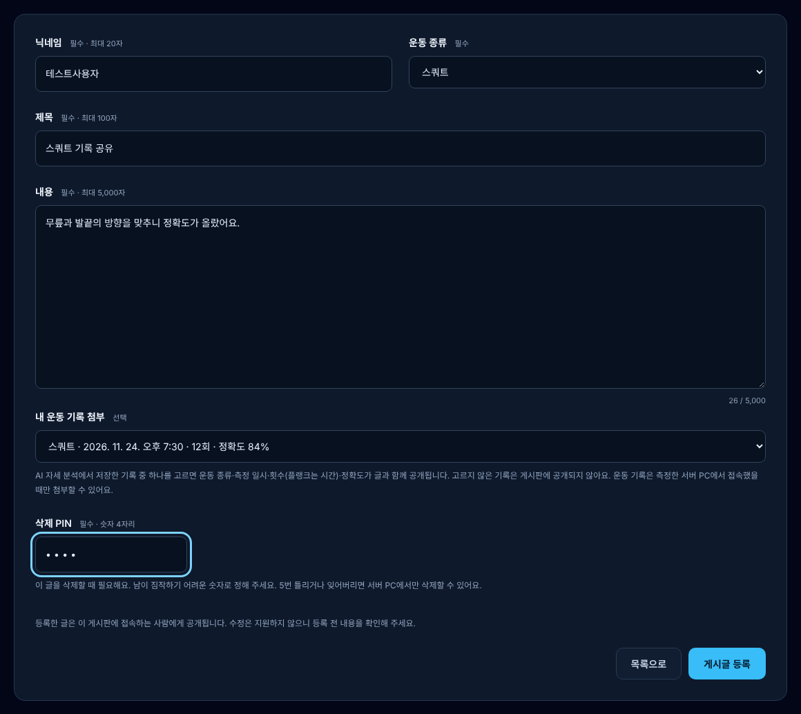
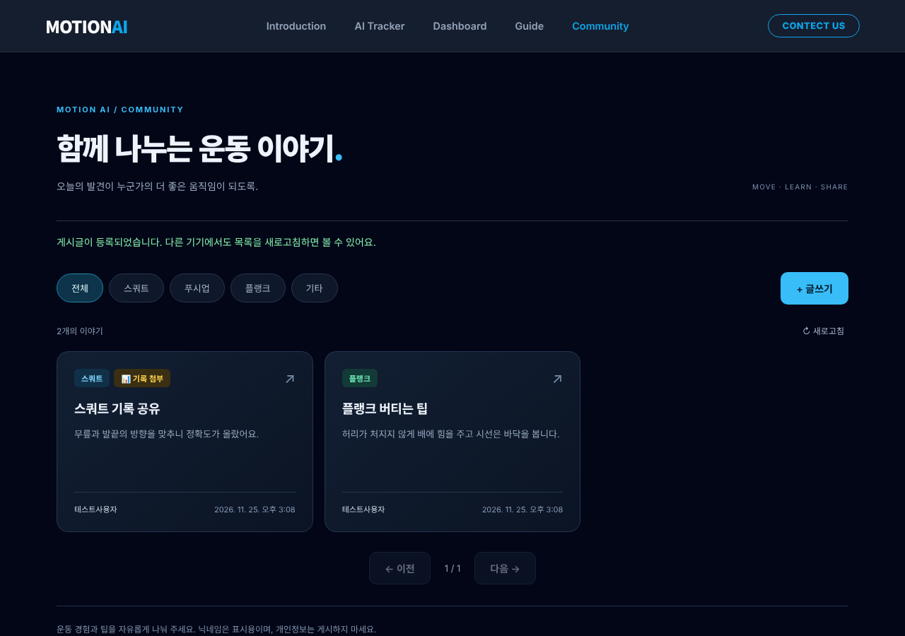

## 3. 게시글 목록 및 상세 내용 조회하기

1. 커뮤니티 목록에서 읽고 싶은 게시글 카드를 선택합니다.
2. 상세 화면의 **운동 종류, 제목, 작성자 닉네임, 작성 시간, 본문**을 확인합니다. 운동 기록을 첨부한 글은 본문 위에 **📊 첨부한 운동 기록** 카드가 함께 표시됩니다.
3. **← 목록으로** 버튼을 눌러 목록에 돌아옵니다.
4. 글이 많으면 목록 아래의 **← 이전**, **다음 →** 버튼으로 페이지를 이동합니다.

**확인 결과:** 로컬 환경에서 게시글 조회 기능은 정상 작동했다는 사용자 확인이 있습니다. 코드는 상세 화면 주소를 `#community/post/게시글번호` 형태로 관리하고 게시글 목록을 최신순으로 가져옵니다. 페이지가 하나일 경우 페이지 이동 버튼은 비활성화됩니다.
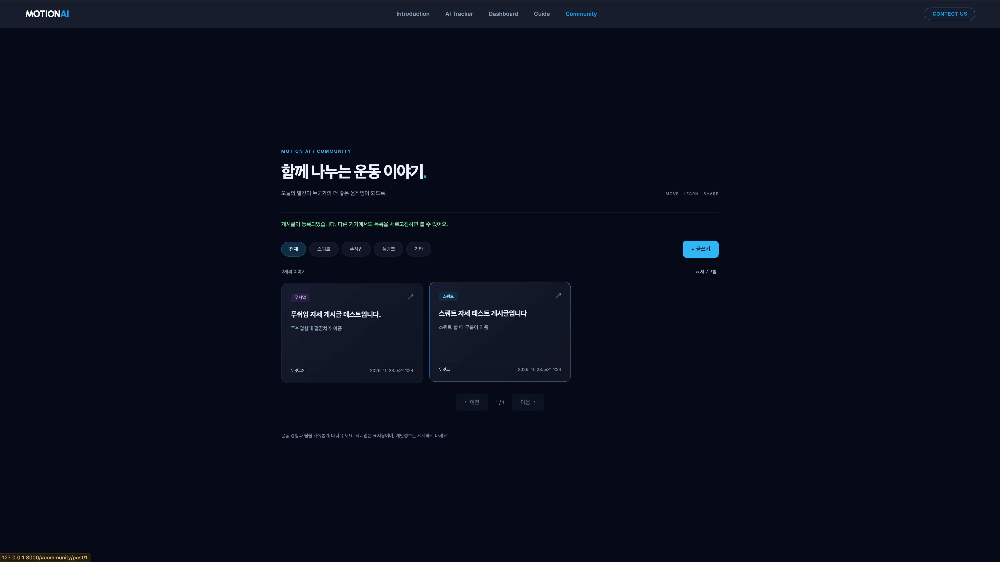

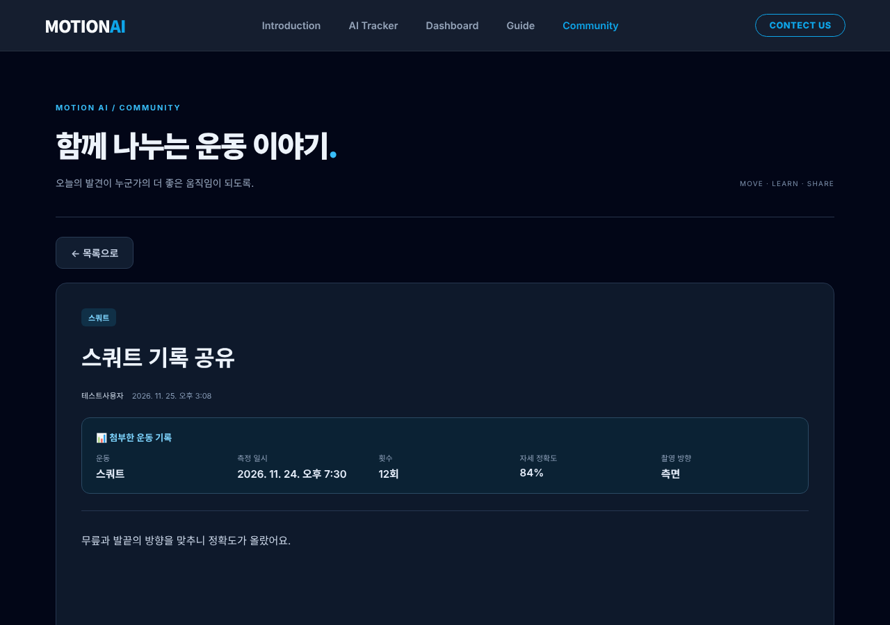

## 4. 운동 종류별 필터 사용하기

1. 커뮤니티 목록에서 **스쿼트** 필터를 선택합니다.
2. 스쿼트에 해당하는 게시글만 표시되는지 확인합니다.
3. **푸시업**, **플랭크**, **기타** 중 다른 필터를 선택해 목록을 비교합니다.
4. **전체**를 누르면 모든 운동 종류의 게시글이 다시 표시됩니다.
5. 목록을 다시 불러오려면 **↻ 새로고침** 버튼을 누릅니다.

**확인 결과:** 로컬 환경에서 운동 종류별 필터가 정상 작동했다는 사용자 확인이 있습니다. 선택한 종류에 글이 없다면 빈 목록 안내가 나타나도록 구현되어 있습니다.
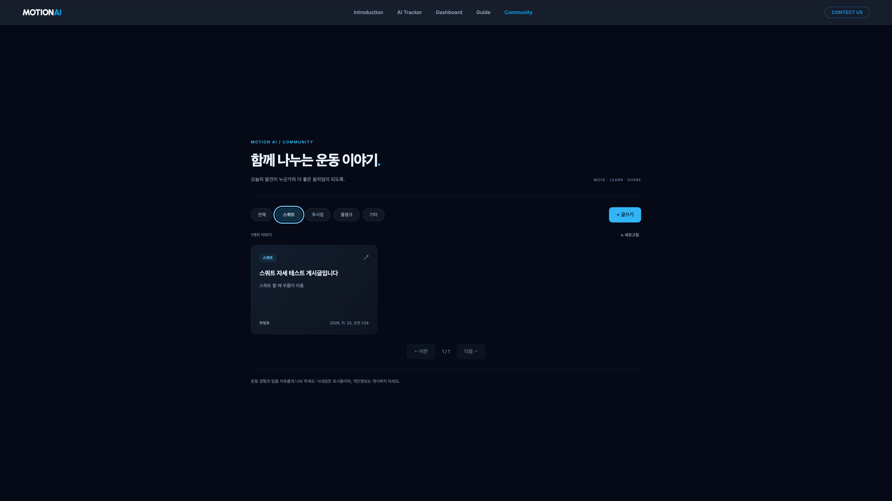

## 5. 댓글 남기기

1. 커뮤니티 목록에서 게시글을 선택해 상세 화면을 엽니다.
2. 본문 아래 **댓글** 영역에서 지금까지 달린 댓글과 댓글 수를 확인합니다. 댓글은 먼저 쓴 순서(오래된 순)로 표시됩니다.
3. **닉네임**과 **댓글**을 입력합니다.
   - 닉네임: 1~20자, 댓글: 1~1,000자(앞뒤 공백 제외)
4. **댓글 등록** 버튼을 누릅니다. 등록되면 **댓글이 등록되었습니다.**라는 안내와 함께 목록에 새 댓글이 나타납니다.
5. 다른 사람이 쓴 댓글을 다시 불러오려면 댓글 영역의 **↻ 새로고침** 버튼을 누릅니다.

**확인 결과:** 로컬 서버에서 댓글 2개를 등록해 목록에 오래된 순으로 표시되고 댓글 수가 올라가는 것을 확인했습니다. 자동 테스트(`tests/test_comments.py`)에서도 등록·조회, 정렬, 글자 수 검사, 서버 재시작 후 유지가 통과했습니다. 댓글이 없으면 **아직 댓글이 없어요. 첫 댓글을 남겨 주세요.**라는 안내가 표시되도록 구현되어 있습니다. 댓글은 등록 후 수정하거나 따로 삭제할 수 없습니다.
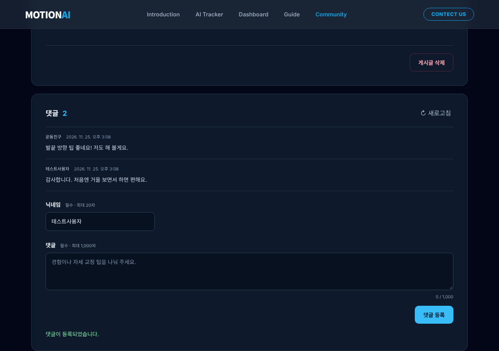

## 6. 게시글 삭제하기

1. 삭제할 게시글의 상세 화면을 엽니다.
2. 본문 아래의 **게시글 삭제** 버튼을 누릅니다.
3. **삭제하면 댓글과 첨부한 운동 기록까지 함께 지워지고 되돌릴 수 없어요.**라는 안내를 확인합니다.
4. 접속한 기기에 따라 다음과 같이 진행합니다.
   - **서버 PC에서 접속한 경우:** PIN 입력 없이 **삭제하기**를 누르면 삭제됩니다. 서버 PC는 관리자 역할을 하므로 모든 글을 삭제할 수 있습니다.
   - **다른 기기에서 접속한 경우:** 글을 쓸 때 정한 **삭제 PIN** 4자리를 입력하고 **삭제하기**를 누릅니다.
5. 삭제되면 목록으로 돌아가고 **게시글이 삭제되었습니다.**라는 안내가 표시됩니다.

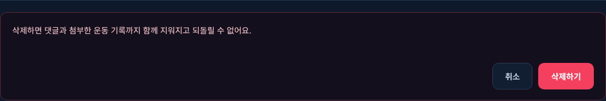
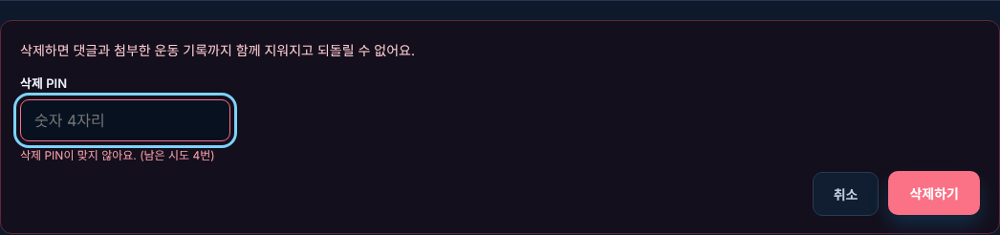
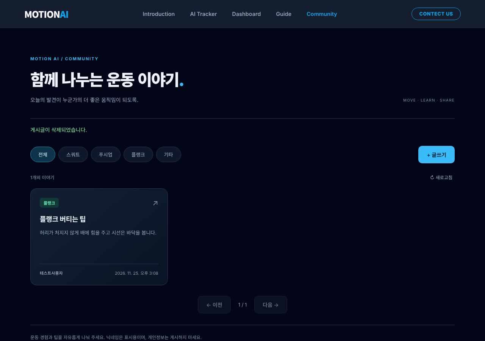

**삭제 PIN 규칙**
- PIN이 틀리면 글은 그대로 남고, 남은 시도 횟수가 안내됩니다.
- **5번 틀리면** 그 글은 PIN으로 삭제할 수 없도록 잠깁니다. 이후에는 맞는 PIN을 넣어도 삭제되지 않으며, 서버 PC에서만 삭제할 수 있습니다.
- PIN 없이 작성된 이전 글은 **서버 PC에서만** 삭제할 수 있습니다.
- PIN은 그대로 저장하지 않고 해시 값으로만 저장하며, 화면이나 API 응답에 노출되지 않습니다.

**확인 결과:** 로컬 서버에서 서버 PC 주소(`127.0.0.1`)로 접속해 PIN 없이 삭제되는 것을 확인했습니다. 또 서버 PC의 네트워크 IP 주소로 접속하면 서버가 다른 기기로 판단하므로, 이 방법으로 틀린 PIN을 넣었을 때 **남은 시도** 안내가 나오고 맞는 PIN으로 삭제되는 것을 확인했습니다. 5회 잠금과 댓글·첨부 기록 동시 삭제는 자동 테스트(`tests/test_post_delete.py`)로 확인했습니다. 실제 휴대폰 등 별도 기기에서의 접속은 이 가이드의 검증 범위 밖입니다.

## 7. 주의 사항 및 문제 해결

| 상황 | 해결 방법 |
| --- | --- |
| 커뮤니티 페이지에 접속되지 않음 | 서버가 실행 중인지 확인하고 **서버를 실행한 같은 PC**에서 `http://127.0.0.1:8000/#community`로 접속합니다. HTML 파일을 직접 더블클릭하지 않습니다. |
| 게시글 목록을 불러오지 못함 | 서버 실행 상태를 확인하고 **↻ 새로고침** 또는 오류 화면의 **다시 시도**를 누릅니다. 오류가 계속되면 서버 터미널 메시지를 확인합니다. |
| 게시글 등록 버튼을 눌러도 저장되지 않음 | 닉네임·운동 종류·제목·내용·삭제 PIN의 필수 입력 여부와 글자 수 제한을 확인합니다. 삭제 PIN은 숫자 4자리여야 합니다. |
| 운동 기록 첨부 목록이 비어 있거나 선택할 수 없음 | 운동 기록은 **기록을 측정한 서버 PC에서 접속했을 때만** 첨부할 수 있습니다. 서버 PC에서도 비어 있다면 AI 자세 분석에서 저장한 기록이 있는지 확인합니다. |
| 댓글이 등록되지 않음 | 닉네임(최대 20자)과 댓글(최대 1,000자)을 입력했는지 확인합니다. 다른 사람이 쓴 댓글이 안 보이면 댓글 영역의 **↻ 새로고침**을 누릅니다. |
| 다른 PC나 휴대폰에서 게시글이 보이지 않음 | **이 가이드는 서버를 실행한 PC의 로컬 환경만 사용·검증 대상으로 합니다.** 다른 기기 접속이나 기기 간 데이터 공유를 지원되는 것으로 안내하지 않습니다. |
| 작성한 글을 수정하고 싶음 | 게시글 **수정** 기능은 없습니다. 등록 전에 내용을 확인하고, 꼭 바꿔야 하면 글을 삭제한 뒤 다시 작성합니다. |
| 삭제 PIN을 잊었거나 5번 틀려 잠김 | PIN을 확인하거나 되돌리는 기능은 없습니다. **서버 PC**에서 해당 글을 열어 PIN 없이 삭제합니다. |
| 게시글 삭제 버튼 대신 "서버 PC에서만 삭제할 수 있어요" 안내가 보임 | 삭제 PIN 없이 작성된 이전 글입니다. 서버 PC에서 삭제합니다. |

### 데이터 저장 방식

게시글과 댓글, 게시글에 첨부한 운동 기록은 기본적으로 프로그램을 실행한 컴퓨터의 **로컬 SQLite 데이터베이스**인 `instance/community.sqlite3`에 저장됩니다. 게시글을 삭제하면 그 글의 댓글과 첨부 기록도 함께 지워집니다. 클라우드 계정에 자동 저장되거나 다른 기기에 자동 동기화되는 방식이 아닙니다.

로컬 서버에서 게시글을 작성·조회할 수 있다는 점은 사용자 테스트로 확인했습니다. **서버 재실행 후 데이터 유지**는 구현상 같은 DB 파일을 사용하도록 되어 있지만, 이번 사용자 확인과 구별하여 추가 검증 항목으로 남깁니다.

**개인정보 주의:** 닉네임은 본인 확인 수단이 아니며, 테스트 게시글과 댓글에는 실명·이메일·전화번호·학번 등 개인정보를 입력하지 않습니다.

## 8. 실행 및 검증 기록

| 검증 항목 | 방법 | 결과 | 근거 |
| --- | --- | --- | --- |
| 커뮤니티 접속 | 로컬 서버 실행 후 `/#community` 접속 | 정상 | 사용자 직접 사용 확인 |
| 게시글 작성 | 필수 항목 작성 후 등록 | 정상 | 사용자 직접 사용 확인 |
| 게시글 조회 | 목록 및 글 내용 확인 | 정상 | 사용자 직접 사용 확인 |
| 운동 종류 필터 | 운동 종류 선택 및 목록 확인 | 정상 | 사용자 직접 사용 확인 |
| 서버 재시작 후 게시글 유지 | 서버 종료·재시작 후 같은 글 조회 | 미검증 | 별도 실행 결과 미확인 |
| 다른 기기 접속·동기화 | 다른 PC/휴대폰에서 접속 및 조회 | 본 가이드 범위 제외 | 로컬 환경만 대상으로 안내 |
| 운동 기록 첨부 | 기록을 골라 글 등록 후 목록·상세 화면 확인 | 정상 | 로컬 실행 확인(캡처 첨부), `tests/test_record_attachment.py` |
| 댓글 작성·조회 | 상세 화면에서 댓글 2개 등록 후 목록 확인 | 정상 | 로컬 실행 확인(캡처 첨부), `tests/test_comments.py` |
| 게시글 삭제(서버 PC) | `127.0.0.1`로 접속해 PIN 없이 삭제 | 정상 | 로컬 실행 확인(캡처 첨부), `tests/test_post_delete.py` |
| 게시글 삭제(PIN) | 서버 PC의 네트워크 IP로 접속해 틀린 PIN → 맞는 PIN 입력 | 정상 | 로컬 실행 확인(캡처 첨부), `tests/test_post_delete.py` |
| 삭제 PIN 5회 잠금 | 5회 실패 후 맞는 PIN으로 삭제 시도 | 자동 테스트 통과 | `tests/test_post_delete.py` |

> **검증 범위 구분:** '정상'은 실제 사용자가 해당 기능을 테스트했을 때 문제가 없었다는 보고이며, 이 문서 작성자가 같은 브라우저 세션을 독립적으로 재현한 결과는 아닙니다. '로컬 실행 확인'은 테스트용 운동 기록을 넣은 로컬 서버를 실행하고 브라우저로 화면을 조작해 확인한 결과입니다. '자동 테스트 통과'는 저장소의 `pytest` 테스트만 통과한 항목입니다.

## 9. 현재 제공하지 않는 기능

현 버전의 커뮤니티 사용자 화면에서는 **게시글 수정, 댓글 수정·삭제, 로그인, 좋아요** 기능을 제공하지 않습니다. 이 가이드에서는 구현된 접속·작성·조회·필터·댓글·게시글 삭제 기능만 다룹니다.
