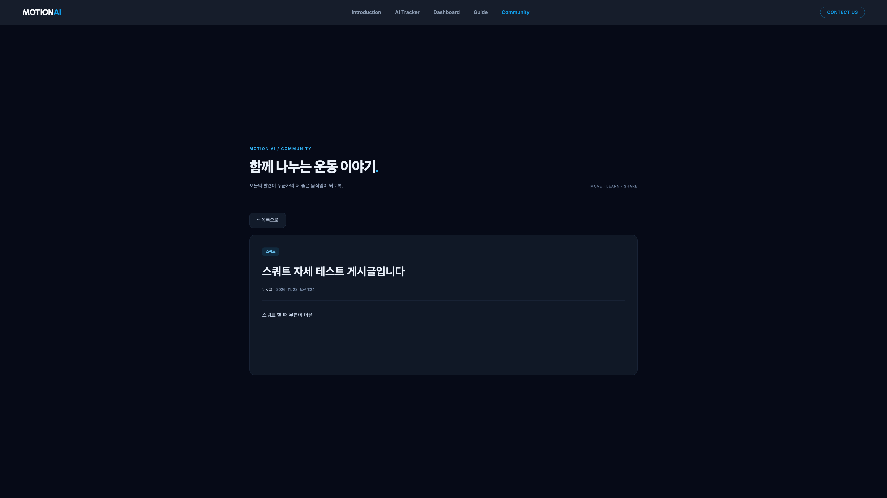

# MOTION AI 커뮤니티 사용자 가이드

MOTION AI의 커뮤니티에서 운동 경험과 자세 교정 팁을 게시글로 작성하고 조회하는 방법을 안내합니다. 처음 사용하는 사람도 화면의 버튼을 순서대로 따라 할 수 있도록 구성했습니다.

> **확인 범위:** GitHub `main` 브랜치의 `README.md`, `static/index.html`, `static/community.js`, `static/community-api.js`, `app.py`, `post_storage.py`를 확인했습니다. 실제 사용자 테스트에서는 **로컬 환경의 커뮤니티 접속·게시글 작성·조회·운동 종류 필터 기능에 문제가 없었다**고 확인되었습니다. 아래 단계별 동작은 코드와 해당 사용자 확인에 근거합니다. 서버 재시작 후 데이터 보존 등 별도로 수행 여부를 확인하지 못한 시험은 구분해 적었습니다.

## 1. 커뮤니티에 접속하기

1. 프로젝트 [README의 설치·실행 안내](../README.md#-설치와-실행)에 따라 **내 컴퓨터에서** MOTION AI 서버를 실행합니다. Windows에서는 `setup.cmd`로 처음 설치한 뒤 `start.cmd`를 사용할 수 있습니다.
2. 같은 컴퓨터의 브라우저에서 `http://127.0.0.1:8000/#community`에 접속합니다. 또는 메인 화면 상단의 **Community** 메뉴를 누릅니다.
3. **함께 나누는 운동 이야기.**라는 제목과 게시글 목록, 운동 종류별 필터가 표시되는지 확인합니다.

**확인 결과:** 사용자가 로컬 환경에서 커뮤니티 접속이 정상 작동했다고 확인했습니다. 게시글이 하나도 없으면 **아직 등록된 이야기가 없어요.**라는 안내가 표시되도록 구현되어 있습니다.

## 2. 게시글 작성하기

1. 커뮤니티 목록의 **+ 글쓰기** 버튼을 누릅니다.
2. **닉네임**, **운동 종류**, **제목**, **내용**을 입력합니다.
   - 운동 종류: **스쿼트 / 푸시업 / 플랭크 / 기타** 중 선택
   - 닉네임: 1~20자, 제목: 1~100자, 내용: 1~5,000자(앞뒤 공백 제외)
3. 내용을 확인하고 **게시글 등록** 버튼을 누릅니다.
4. 목록으로 돌아왔을 때 작성한 글이 나타나는지 확인합니다.

**확인 결과:** 로컬 환경에서 게시글 작성이 정상 작동했다는 사용자 확인이 있습니다. 코드상 정상 등록 시 목록으로 돌아가고 **게시글이 등록되었습니다.**라는 안내를 표시합니다. 빈 입력이나 길이 제한 위반 시 해당 항목에 오류 안내가 나타납니다.

**연습용 예시:** 닉네임 `테스트사용자` / 운동 종류 `스쿼트` / 제목 `스쿼트 자세 팁` / 내용 `무릎과 발끝의 방향을 확인합니다.`

## 3. 게시글 목록 및 상세 내용 조회하기

1. 커뮤니티 목록에서 읽고 싶은 게시글 카드를 선택합니다.
2. 상세 화면의 **운동 종류, 제목, 작성자 닉네임, 작성 시간, 본문**을 확인합니다.
3. **← 목록으로** 버튼을 눌러 목록에 돌아옵니다.
4. 글이 많으면 목록 아래의 **← 이전**, **다음 →** 버튼으로 페이지를 이동합니다.

**확인 결과:** 로컬 환경에서 게시글 조회 기능은 정상 작동했다는 사용자 확인이 있습니다. 코드는 상세 화면 주소를 `#community/post/게시글번호` 형태로 관리하고 게시글 목록을 최신순으로 가져옵니다. 페이지가 하나일 경우 페이지 이동 버튼은 비활성화됩니다.

## 4. 운동 종류별 필터 사용하기

1. 커뮤니티 목록에서 **스쿼트** 필터를 선택합니다.
2. 스쿼트에 해당하는 게시글만 표시되는지 확인합니다.
3. **푸시업**, **플랭크**, **기타** 중 다른 필터를 선택해 목록을 비교합니다.
4. **전체**를 누르면 모든 운동 종류의 게시글이 다시 표시됩니다.
5. 목록을 다시 불러오려면 **↻ 새로고침** 버튼을 누릅니다.

**확인 결과:** 로컬 환경에서 운동 종류별 필터가 정상 작동했다는 사용자 확인이 있습니다. 선택한 종류에 글이 없다면 빈 목록 안내가 나타나도록 구현되어 있습니다.

## 5. 주의 사항 및 문제 해결

| 상황 | 해결 방법 |
| --- | --- |
| 커뮤니티 페이지에 접속되지 않음 | 서버가 실행 중인지 확인하고 **서버를 실행한 같은 PC**에서 `http://127.0.0.1:8000/#community`로 접속합니다. HTML 파일을 직접 더블클릭하지 않습니다. |
| 게시글 목록을 불러오지 못함 | 서버 실행 상태를 확인하고 **↻ 새로고침** 또는 오류 화면의 **다시 시도**를 누릅니다. 오류가 계속되면 서버 터미널 메시지를 확인합니다. |
| 게시글 등록 버튼을 눌러도 저장되지 않음 | 닉네임·운동 종류·제목·내용의 필수 입력 여부와 글자 수 제한을 확인합니다. |
| 다른 PC나 휴대폰에서 게시글이 보이지 않음 | **이 가이드는 서버를 실행한 PC의 로컬 환경만 사용·검증 대상으로 합니다.** 다른 기기 접속이나 기기 간 데이터 공유를 지원되는 것으로 안내하지 않습니다. |
| 작성한 글을 수정하거나 삭제하고 싶음 | 현재 커뮤니티 사용자 화면에는 **게시글 수정·삭제** 기능이 없습니다. 등록 전에 내용을 확인합니다. |

### 데이터 저장 방식

게시글은 기본적으로 프로그램을 실행한 컴퓨터의 **로컬 SQLite 데이터베이스**인 `instance/community.sqlite3`에 저장됩니다. 클라우드 계정에 자동 저장되거나 다른 기기에 자동 동기화되는 방식이 아닙니다.

로컬 서버에서 게시글을 작성·조회할 수 있다는 점은 사용자 테스트로 확인했습니다. **서버 재실행 후 데이터 유지**는 구현상 같은 DB 파일을 사용하도록 되어 있지만, 이번 사용자 확인과 구별하여 추가 검증 항목으로 남깁니다.

**개인정보 주의:** 닉네임은 본인 확인 수단이 아니며, 테스트 게시글에는 실명·이메일·전화번호·학번 등 개인정보를 입력하지 않습니다.

## 6. 실행 및 검증 기록

| 검증 항목 | 방법 | 결과 | 근거 |
| --- | --- | --- | --- |
| 커뮤니티 접속 | 로컬 서버 실행 후 `/#community` 접속 | 정상 | 사용자 직접 사용 확인 |
| 게시글 작성 | 필수 항목 작성 후 등록 | 정상 | 사용자 직접 사용 확인 |
| 게시글 조회 | 목록 및 글 내용 확인 | 정상 | 사용자 직접 사용 확인 |
| 운동 종류 필터 | 운동 종류 선택 및 목록 확인 | 정상 | 사용자 직접 사용 확인 |
| 서버 재시작 후 게시글 유지 | 서버 종료·재시작 후 같은 글 조회 | 미검증 | 별도 실행 결과 미확인 |
| 다른 기기 접속·동기화 | 다른 PC/휴대폰에서 접속 및 조회 | 본 가이드 범위 제외 | 로컬 환경만 대상으로 안내 |

> **검증 범위 구분:** '정상'은 실제 사용자가 해당 기능을 테스트했을 때 문제가 없었다는 보고이며, 이 문서 작성자가 같은 브라우저 세션을 독립적으로 재현한 결과는 아닙니다.

## 7. 현재 제공하지 않는 기능

현 버전의 커뮤니티 사용자 화면에서는 **댓글, 게시글 수정·삭제, 로그인, 좋아요** 기능을 제공하지 않습니다. 이 가이드에서는 구현된 접속·작성·조회·필터 기능만 다룹니다.
