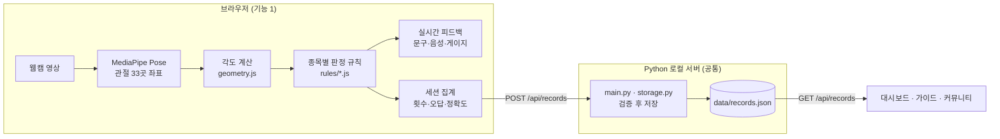

# 기능 1. AI 실시간 자세 분석 (AI Posture Tracker)

| 항목 | 내용 |
| --- | --- |
| 담당 | 김원빈 ([@PLMOKN044330-SHIP-IT](https://github.com/PLMOKN044330-SHIP-IT)) |
| 역할 | 개발 리드 |
| 브랜치 | `feature/posture-tracker` (이슈 단위: `fix/session-error-reset`, `fix/plank-offscreen-time`, `feature/tracker-time-judge` 등) |
| MVP | 10주차 중간발표 (11/6): 스쿼트 횟수 측정, 스쿼트 오답 3종 안내, 기록 저장 |
| 완성 | 13주차 기능 동결 (11/27) 전: 3종목(스쿼트·푸시업·플랭크), 필수 오답 13종 전체 |

---

## 1. 담당 역할

### 기능 1 담당
- 웹캠 영상에서 실시간 프레임별 관절 좌표를 얻고, 그 좌표에 의미를 붙여 자세의 정답·오답을 판정하는 엔진을 만듭니다.
- 판정 결과를 화면 문구, 음성, 정확도 게이지로 실시간 안내합니다.
- 운동이 끝나면 결과를 공통 기록 양식으로 서버에 저장합니다.

### 개발 리드로서 맡는 공통 부분
- **공통 기록 양식 정의:** 운동이 끝난 후 기록 저장용 데이터의 양식, 네 기능이 공유하는 유일한 연결 지점.
- **서버 뼈대:** `main.py`(페이지·API 라우팅), `storage.py`(기록 읽기·쓰기·검증)
- **예시 기록 파일:** `data/sample-records.json`. 다른 기능이 트래커 없이 개발·검증할 때 씁니다.
- **기술 판단:** 병합 시 구조·데이터 형식 관련 판단

---

## 2. 핵심 구현 기능

| 기능 | 설명 |
| --- | --- |
| 관절 추출 | MediaPipe Pose로 측면 영상에서 관절·부위 33곳의 좌표를 매 프레임 추출 |
| 각도 계산 | 좌표를 픽셀 단위로 바꾼 뒤 관절 각도와 몸통 정렬 각도를 계산 |
| 반복 측정 | 스쿼트·푸시업 횟수, 플랭크 바른 자세 유지 시간(초) |
| 오답 판정 | 종목별 필수 오답 자세 13종(스쿼트 4, 푸시업 5, 플랭크 4) |
| 실시간 피드백 | 화면 문구와 음성(TTS)을 같은 내용으로 안내, 정상 반복 시 효과음, 정확도 게이지 |
| 기록 저장 | 종료 시 횟수·정확도·오답별 횟수를 공통 양식으로 서버에 전송 |

---

## 3. 기술 스택 및 시스템 구성

| 구분 | 사용 기술 | 비고 |
| --- | --- | --- |
| 자세 인식 | MediaPipe Pose Landmarker (`@mediapipe/tasks-vision`, 버전 고정) | 브라우저에서 실행 |
| 판정·피드백 | JavaScript (ES Modules), Web Speech API(음성), Web Audio API(효과음) | 브라우저에서 실행 |
| 서버 | Python 3.12+, Flask | `python main.py`로 로컬 서버 실행 |
| 저장 | JSON 파일 (`data/records.json`) | 원격 DB 없음 |

카메라 영상 처리를 브라우저에서 하는 이유 : 영상을 서버로 보내지 않기 위해서. 운동 영상이 밖으로 나가지 않고 전송 지연도 없음. 기록 검증·저장은 Python 서버에 위임.



네 기능은 서로의 코드를 직접 호출하지 않고 **공통 기록 양식 하나만**. 다른 기능들도 예시 기록 파일만 있으면 독립적으로 개발·검증 가능.

---

## 4. 설계 초안

### 4.1 폴더 구조

```
main.py                     # 서버 실행, 페이지·API 라우팅 (공통)
storage.py                  # 기록 읽기·쓰기·검증 (공통)
data/
  records.json              # 실제 기록 (커밋하지 않음)
  sample-records.json       # 예시 기록 (팀 공용)
static/tracker/
  tracker.html
  js/pose-engine.js         # MediaPipe 초기화, 랜드마크 추출
  js/geometry.js            # 각도 계산 (순수 함수)
  js/rules/squat.js         # 종목별 판정 규칙 (순수 함수)
  js/rules/pushup.js
  js/rules/plank.js
  js/feedback.js            # 문구·음성·효과음·게이지
  js/session.js             # 세션 집계, 저장 요청
tests/fixtures/             # 녹화한 랜드마크 JSON (카메라 없이 판정 로직 테스트)
```

### 4.2 공통 기록 양식 (초안)

```json
{
  "id": "6f2c1a9e-4b7d-4e3a-9c51-2d8e7f0b3a64",
  "startedAt": "2026-10-27T19:30:12+09:00",
  "exercise": "squat",
  "view": "side",
  "count": 12,
  "accuracy": 71,
  "errors": {
    "squat":  { "torsoLean": 1, "shinLean": 0, "heelLift": 1, "partialRep": 2, "kneeValgus": 0 },
    "pushup": { "coreDrop": 0, "coreHigh": 0, "handForward": 0, "handBackward": 0, "partialRep": 0 },
    "plank":  { "hipDrop": 0, "hipHigh": 0, "neckDrop": 0, "neckHigh": 0 }
  }
}
```

| 필드 | 뜻 | 규칙 |
| --- | --- | --- |
| `id` | 기록 고유 번호 (UUID) | 중복 불러오기·삭제 구분용 |
| `startedAt` | 운동 시작 시각 (ISO 8601) | 정렬 기준 |
| `exercise` | 종목 | `squat` · `pushup` · `plank` |
| `view` | 촬영 시점 | `side` · `front`. 지금은 항상 `side` |
| `count` | 수행량 | 스쿼트·푸시업: 횟수 / 플랭크: 바른 자세 유지 시간(초). 0이면 저장하지 않음 |
| `accuracy` | 정확도 | 0~100 정수 (4.5절) |
| `errors` | 오답별 발생 횟수 | 3종목 14개 키(예약 1개 포함)를 모두 포함. **그 세션에서만 센 값**. 이전 세션 값이 섞이면 안 됨. `kneeValgus`는 정면 모드용 예약 키로, 측면 세션에서는 항상 0 |

### 4.3 각도 정의

모든 각도는 정규화 좌표에 영상 가로·세로 픽셀 수를 곱한 뒤 계산합니다. MediaPipe가 찍어 주는 점 자체는 바꾸지 않습니다. 이렇게 해야 카메라 화면비에 따라 각도가 왜곡되지 않습니다.

| 이름 | 계산 | 기준 |
| --- | --- | --- |
| 허벅지-수직 각 | 엉덩이→무릎 선과 수직선 | 0° 서 있음, 90° 허벅지 수평 |
| 몸통 기울기 | 엉덩이→어깨 선과 수직선 | 0° 꼿꼿이 섬 |
| 정강이 기울기 | 발목→무릎 선과 수직선 | 0° 정강이 수직 |
| 몸통-정강이 각 | 몸통 기울기 − 정강이 기울기 | 0° 두 선이 평행 |
| 팔꿈치 각 | 어깨-팔꿈치-손목 사잇각 | 180° 팔 펴짐 |
| 몸통 정렬 각 | 어깨-엉덩이-발목 사잇각 | 180° 일직선 |
| 팔 기울기 | 어깨→손목 선과 수직선, 손목이 머리 쪽이면 + | 0° 손이 어깨 바로 아래 |
| 목 정렬 각 | 귀-어깨-엉덩이 사잇각 | 180° 머리와 몸통이 일직선 |
| 발 각도 | 뒤꿈치→발끝 선과 수평선 | 반복 시작 때 값과 비교 |
| 몸 수평 각 | 어깨→발목 선과 수평선 | 0° 몸이 수평 |

### 4.4 판정 규칙 (초안)

원칙은 "정렬은 기준선에서 10° 넘게 벗어나면 오답", 개인 신체 특성 보정 없이 쓸 수 있는 문헌·공식 프로토콜·레퍼런스 프로그램의 수치를 기준으로.

**진입 조건** ("운동 중인가"를 가르는 기준, 자세 품질 기준 아님)

- 푸시업·플랭크: 몸 수평 각 ≤ 45°(누운 자세)이고, 손목(푸시업) 또는 팔꿈치(플랭크)가 어깨보다 아래일 때만 측정
- 스쿼트: 서기 상태(허벅지-수직 각 ≤ 30°)에서 시작해야 측정
- 미충족 시간은 반복 측정, 플랭크 시간, 오답 지속 시간에서 모두 빼고 "운동 자세를 잡아 주세요" 안내. 45°는 팀 설정값

**반복 측정**

| 종목 | 규칙 | 근거 |
| --- | --- | --- |
| 스쿼트 | 허벅지-수직 각 ≥ 70°까지 내려갔다가 ≤ 30°로 돌아오면 1회. 범위를 못 채우면 세지 않고 안내 | LearnOpenCV AI Fitness Trainer (초급 모드) |
| 푸시업 | 팔꿈치 각 ≤ 90°까지 내려갔다가 ≥ 160°로 돌아오면 1회. 범위를 못 채우면 세지 않고 안내 | FitnessGram 90° 푸시업 |
| 플랭크 | 오답 경고가 없는 시간만 누적, 관절이 보이지 않거나 진입 조건을 벗어난 시간은 제외 | 플랭크 테스트 (직선 유지 시간) |

- **반복 시도:** 스쿼트는 허벅지-수직 각 > 35°, 푸시업은 팔꿈치 각 < 125°부터 반복 시도로 봅니다.
- **올바른 반복:** 카운트 조건을 채웠고, 그 반복 동안 오답이 0회인 반복입니다.
- **화면 표시:** "전체 n회 / 올바른 n회"를 함께 보여 줍니다.

**필수 오답 13종**

| 종목 | 키 | 오답 | 조건 | 근거 |
| --- | --- | --- | --- | --- |
| 스쿼트 | `torsoLean` | 상체 과다 숙임 | 통과 구간 몸통-정강이 각 중앙값 > +25° | Straub & Powers (2024)의 10° + 측정 여유 15° |
| 스쿼트 | `shinLean` | 정강이 과다 기울기 | 통과 구간 몸통-정강이 각 중앙값 < −25° | Straub & Powers (2024)의 10° + 측정 여유 15° |
| 스쿼트 | `heelLift` | 뒤꿈치 들림 | 통과 구간 발 각도 중앙값이 반복 직전 선 자세보다 15° 넘게 큼 | 팀 설정값 10° + 측정 여유 5° |
| 스쿼트 | `partialRep` | 범위 미달 | 허벅지-수직 각이 35°를 넘었다가 70°에 못 미치고 30° 이하로 돌아옴 | LearnOpenCV (반복 측정 기준) |
| 푸시업 | `coreDrop` | 허리 처짐 | 몸통 정렬 각 < 160°, 엉덩이가 어깨-발목 선 아래 | FitnessGram 직선 기준 + 10° + 측정 여유 10° |
| 푸시업 | `coreHigh` | 엉덩이 솟음 | 몸통 정렬 각 < 160°, 엉덩이가 선 위 | FitnessGram 직선 기준 + 10° + 측정 여유 10° |
| 푸시업 | `handForward` | 손이 너무 앞 | 팔이 펴진 상태(팔꿈치 ≥ 160°)에서 팔 기울기 > +15° | 손은 어깨 바로 아래(FitnessGram) + 10° + 측정 여유 5° |
| 푸시업 | `handBackward` | 손이 너무 뒤 | 팔이 펴진 상태(팔꿈치 ≥ 160°)에서 팔 기울기 < −15° | 손은 어깨 바로 아래(FitnessGram) + 10° + 측정 여유 5° |
| 푸시업 | `partialRep` | 범위 미달 | ① 125° 아래로 내려갔다가 90°에 못 미치고 160° 이상으로 돌아옴<br>② 90° 도달 후 125°를 넘어 올라왔다가 160°에 못 미치고 다시 125° 아래로 내려감 | FitnessGram 90° (반복 측정 기준) |
| 플랭크 | `hipDrop` | 엉덩이 처짐 | 몸통 정렬 각 < 160°, 엉덩이가 선 아래 | 플랭크 테스트 + 10° 프로토콜 + 측정 여유 10° |
| 플랭크 | `hipHigh` | 엉덩이 솟음 | 몸통 정렬 각 < 160°, 엉덩이가 선 위 | 플랭크 테스트 + 10° 프로토콜 + 측정 여유 10° |
| 플랭크 | `neckDrop` | 고개 숙임 | 목 정렬 각 < 145°, 귀가 어깨-엉덩이 연장선 아래 | 팀 설정값 (테스트로 조정) |
| 플랭크 | `neckHigh` | 고개 듦 | 목 정렬 각 < 145°, 귀가 어깨-엉덩이 연장선 위 | 팀 설정값 (테스트로 조정) |

목 방향은 "코가 귀보다 아래/위"가 아니라 "귀가 어깨-엉덩이 연장선 아래/위"로 판정합니다. 플랭크에서는 바른 자세에서도 코가 귀보다 아래에 있기 때문입니다.

선택 항목(여유가 생기면): 푸시업 `neckDrop`/`neckHigh`(플랭크 규칙 재사용), 플랭크 팔꿈치 위치(엉덩이-어깨-팔꿈치 각 90°±10°). `kneeValgus`는 정면 모드(스쿼트만, 여유가 생기면)용 예약 키입니다.

### 4.5 오답 횟수와 정확도

- **오답 1회:** 같은 오답 조건이 **0.4초 이상** 이어지면 1회로 기록하고 화면·음성으로 안내합니다. 조건이 풀릴 때까지는 다시 세지 않습니다. 프레임 수가 아니라 시간 기준이므로 기기 성능과 무관하게 같게 동작합니다.
- **경고음 쿨다운:** 같은 경고음은 2.5초 안에 반복하지 않습니다.
- **스쿼트·푸시업 정확도:** 올바른 반복 수 ÷ (카운트된 반복 수 + `partialRep` 횟수) × 100
- **플랭크 정확도:** 바른 자세 유지 시간 ÷ (바른 자세 시간 + 오답 경고 시간) × 100

### 4.6 서버 API (초안)

| 메서드 | 경로 | 설명 | 응답 |
| --- | --- | --- | --- |
| `POST` | `/api/records` | 기록 1건 저장. 필수 필드, 종목 값, `count > 0`, `accuracy` 0~100, 오답 키를 검증 | 201 + `id` / 400 + 오류 사유 |
| `GET` | `/api/records` | 전체 기록을 `startedAt` 최신순으로 반환 | 200 + 기록 배열 |

---

## 5. 완료 기준

### MVP (10주차 중간발표, 11/6)
- [ ] 스쿼트를 하면 횟수가 화면에 표시된다. 기준 범위를 못 채운 반복은 세지 않고 안내한다
- [ ] 스쿼트 오답 3종(`torsoLean`·`shinLean`·`heelLift`)이 감지되면 화면 문구와 음성이 같은 내용으로 안내된다
- [ ] 종료 버튼을 누르면 공통 양식에 맞는 기록 1건이 서버에 저장된다

### 최종 (13주차 기능 동결 전, 11/27)

| # | 완료 조건 | 확인 방법 |
| --- | --- | --- |
| 1 | 종목을 선택하고 운동하면 스쿼트·푸시업 횟수와 플랭크 유지 시간(초)이 화면에 표시된다 | 3종목 각각 실제 수행 후 화면 확인 |
| 2 | 오답이 지속되면 화면 문구와 음성이 같은 내용으로 안내되고, 해당 오답 횟수가 1 증가한다 | 의도적 오답 자세 → 안내 문구·음성 일치, 저장된 기록의 해당 키 확인 |
| 3 | 종료 버튼을 누르면 공통 양식에 맞는 기록 1건이 서버에 저장된다 | `data/records.json` 확인, 잘못된 기록은 400 응답 |
| 4 | 세션을 이어서 해도 이전 오답이 섞이지 않고, 화면 밖에 있던 시간은 플랭크 기록에서 빠진다 | 새로고침 없이 2세션 연속 수행 후 기록 비교, 플랭크 중 화면 밖 10초 이탈 후 시간 확인 |

---

## 6. 일정

| 주차 | 날짜 | 할 일 |
| --- | --- | --- |
| 6주 | 10/9 | 담당 기능 이슈 등록, 서버 뼈대(`main.py`, `storage.py`), 예시 기록 파일, 기록 양식 문서 |
| 7주 | 10/16 | `feature/posture-tracker` 브랜치에서 프로토타입 이식, 모듈 분리 후 첫 동작 코드 Push |
| 8주 | 10/23 | 중간고사 |
| 9주 | 10/30 | 첫 풀 리퀘스트: 스쿼트 판정 기준 교체, 세션 오답 초기화 버그 수정 |
| 10주 | 11/6 | MVP 시연: 스쿼트 횟수, 오답 3종 안내, 기록 저장 |
| 11~12주 | 11/13~11/20 | 푸시업·플랭크 규칙, 시간 기준 판정, 플랭크 시간 버그 수정 |
| 13주 | 11/27 | 기능 동결: 3종목 필수 오답 13종 완성, 이후 버그 수정·문서만 |
| 14주 | 12/4 | v1.0.0 릴리스 |

---

## 참고 자료

- Google, [MediaPipe Pose Landmarker](https://ai.google.dev/edge/mediapipe/solutions/vision/pose_landmarker)
- Straub, R. K., & Powers, C. M. (2024). A Biomechanical Review of the Squat Exercise: Implications for Clinical Practice. *International Journal of Sports Physical Therapy*, 19(4), 490–501. https://doi.org/10.26603/001c.94600
- Clinical Estimation of the Use of the Hip and Knee Extensors During Athletic Movements Using 2D Video (2021). *Journal of Applied Biomechanics*, 37(5). https://doi.org/10.1123/jab.2021-0055
- The Cooper Institute, *FITNESSGRAM Administration Manual* (90° Push-Up). Human Kinetics.
- Strand, S. L., et al. (2014). Norms for an Isometric Muscle Endurance Test. *Journal of Human Kinetics*, 40, 93–102. https://doi.org/10.2478/hukin-2014-0011
- ClinicalTrials.gov, [NCT07016139](https://clinicaltrials.gov/study/NCT07016139) (몸통 정렬 10° 이탈 시 검사 종료 기준)
- LearnOpenCV, [Build an AI Fitness Trainer Using MediaPipe For Squat Analysis](https://learnopencv.com/ai-fitness-trainer-using-mediapipe/)
